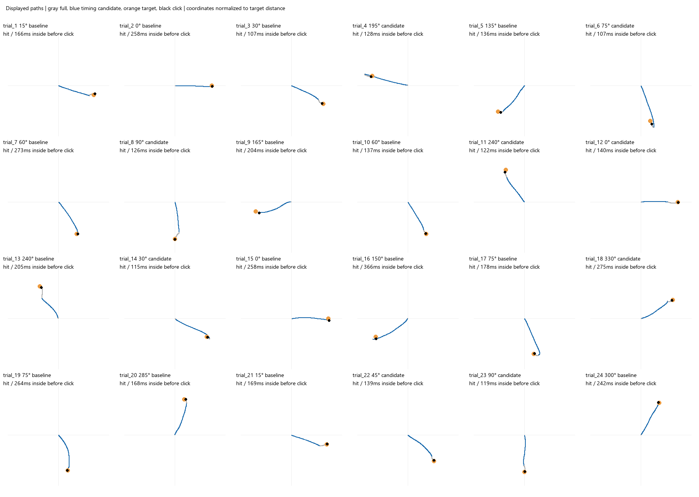

# Directional sensitivity

A fixed-point mouse filter that gives each diagonal its own gain. It is inspired by Corsair's PureVector, but it is my own design and not a reproduction of it.

**User space only.** The tools replay, calibrate, record and preview. `driver/` holds an experimental kernel filter that has never been installed. Leave it that way until someone has reviewed it.



Cursor paths recorded by the app's comparison mode: 24 trials, some with the baseline and some with a candidate profile.

## How it works

The four cardinal directions stay at exactly 1.0. Four diagonal anchors (NE, SE, SW, NW) each carry an X gain and a Y gain, and the filter blends between them with a smoothstep of how diagonal the movement is:

```
r  = min(|x|, |y|) / max(|x|, |y|)      0 on an axis, 1 on an exact diagonal
w  = r * r * (3 - 2 * r)
gx = 1 + w * (anchor_x - 1)
gy = 1 + w * (anchor_y - 1)
```

- No floating point, no allocation and no logging on the packet path. Anchors are Q16.16 and the maths runs in Q24, with rounding that carries fractions between packets.
- Cardinal and zero packets pass through unchanged and do not release stored fractions.
- A packet that would overflow comes back untouched and clears the carry.
- Equal X and Y gains keep the heading of the movement. Unequal gains change it on purpose.
- It cannot see a physical diagonal that the mouse reports as alternating cardinal packets. Smoothing would hide that, so it does not smooth.

## What I found

I recorded a guided baseline task (96 randomized targets), fitted a candidate profile from it, and ran randomized baseline-versus-candidate comparisons inside the app. The candidate changed one quadrant only: a north-west gain of 1.09.

| Complete run | Condition | Hits | Hit rate | Mean arm-to-click on hits |
| --- | --- | --- | --- | --- |
| 002 | Baseline | 46 / 48 | 95.8% | 747 ms |
| 002 | Candidate | 43 / 48 | 89.6% | 789 ms |

The candidate showed no improvement. In its north-west targets it hit 6 of 6 against 5 of 6, but the interval on that gain is far too wide to call it an improvement, so I left my everyday sensitivity alone. [docs/comparison-results.md](docs/comparison-results.md) has the audit, and the raw recordings are not in this repo.

## Tools

| Tool | What it does |
| --- | --- |
| `replay` | Runs a CSV of relative counts, or a generated stream, through the filter. Writes residual diagnostics and a 1M-packet benchmark. |
| `calibrate` | Fits linked diagonal gains from labelled flick traces. Refuses to export a profile that fails its validation split. |
| `recorder` | The guided baseline and comparison task. Records packets, misses and displayed endpoints. |
| `preview` | A foreground Win32 window showing original and transformed movement for one mouse you pick. It does not inject input. |
| `raw_capture`, `driver_ctl` | Raw Input capture and driver control. Read the source before you run either. |

## Build and test

Windows, a C++17 compiler and CMake:

```
cmake -S . -B build -DDIRECTIONAL_BUILD_DRIVER=OFF
cmake --build build --config Release
ctest --test-dir build -C Release --output-on-failure
```

`scripts/build.ps1` does the same with the Visual Studio Build Tools. New targets build with `/W4 /WX /EHsc` under MSVC. Building does not install or activate anything.

```
Get-Content examples/motions.csv | build/Release/replay.exe --ne 1.5 1.5
```

[docs/USAGE.md](docs/USAGE.md) covers every option, the profile format and the benchmark.

## Status

The maths, state handling, profile parsing and command-line behaviour have automated tests. The recorder has recorded real sessions, including the runs above. The live preview window has not been checked at a real mouse yet, and the kernel driver has had no review. A successful build says none of that is done.

The benchmark measures CPU replay only. It says nothing about driver, USB or end-to-end latency, and a zero sample means the clock could not resolve the interval.

## Read next

- [docs/USAGE.md](docs/USAGE.md): commands and file formats.
- [docs/recorder.md](docs/recorder.md): the guided task, its controls and its limits.
- [docs/preview.md](docs/preview.md): how the preview reads Raw Input.
- [docs/personal-model.md](docs/personal-model.md): how the candidate was fitted and why it stays experimental.

MIT license.
